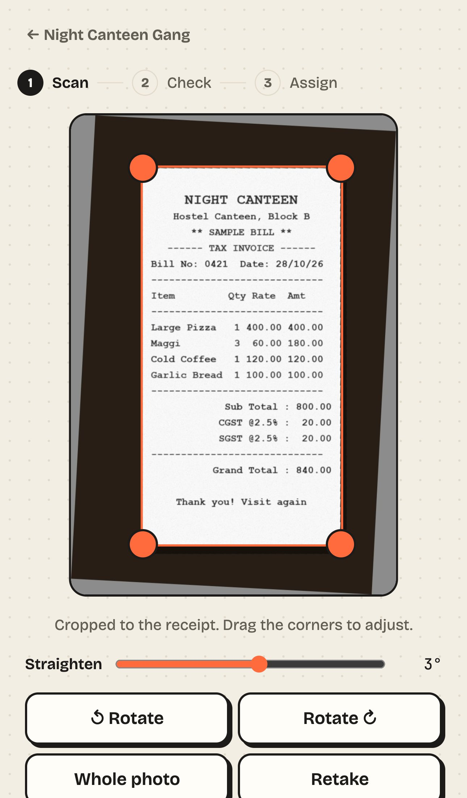
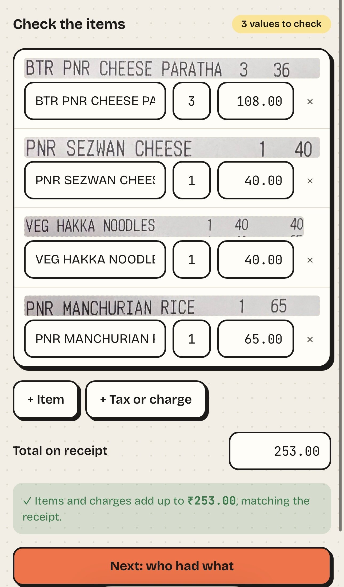
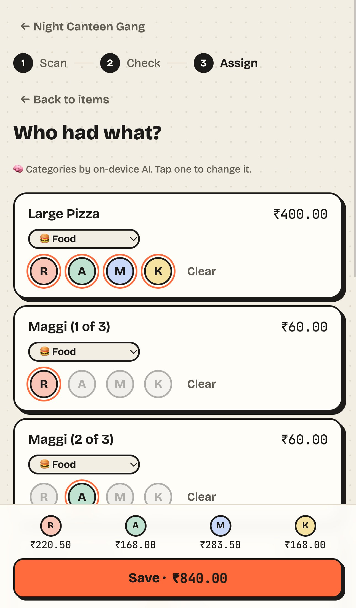
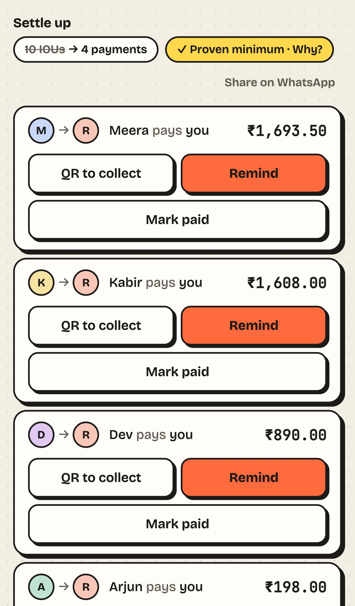
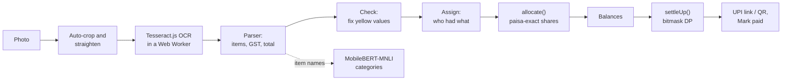

# SplitSmart

Scan a hostel receipt, fix what the scanner got wrong, assign items to the people who had them, and settle up with the fewest possible payments. Everything runs in the browser, and receipts never leave your device.

Built by **Team Web Architects, Hostel 18** for Web Brawl GC 2026.

**Live app:** https://atharv-iit-bombay.github.io/splitsmart/
**Demo video:** https://youtu.be/BSfZRLivPok

**Lighthouse** (live site): laptop **100 · 100 · 100 · 100**, phone **96 · 100 · 100 · 100** (performance · accessibility · best practices · SEO). 125 unit tests, MIT licensed.

<p align="center">
  
  
  
  
</p>

## Why SplitSmart?

What problem it solves: Splitting hostel bills by hand is painful. This app gets rid of the messy mental math, forgotten debts, and having to send those awkward WhatsApp reminders to your friends.

Who it's for: Perfect for hostel rooms, wings, group trips, and late-night canteen runs.

What makes it different: Instead of typing everything out, you just scan the receipt and tap who ate what. It automatically figures out how to settle up with the fewest payments possible, and keeps everything right on your phone.

### Highlights

- **Provably fewest payments.** Not a greedy guess: an exact search over every way to group people, with a "Why?" right in the app.
- **GST split by what you ate, exact to the paisa.** ₹100 ÷ 3 is always 33.34 + 33.33 + 33.33.
- **Reads the bill on your phone.** OCR and AI run on the device, so photos never leave it, and it works offline.
- **Fix it in a tap.** Unsure words are highlighted yellow, and each line shows its own strip of the photo.
- **No server, no sign-up.** Share a whole group by link or QR code.

## Features by tier

### Tier 1: Core ✅
- [x] Create, rename and delete groups; add and remove members with an avatar and colour; switch groups from one dashboard with totals
- [x] Upload a JPG/PNG or take a photo; preview with auto-crop, **auto-straighten**, rotate and retake
- [x] OCR in a Web Worker with a progress bar and scan-line animation; the screen never freezes
- [x] Items with name, quantity, rate and line total; subtotal, CGST/SGST/IGST, service charge, discount, round-off and grand total; addresses, GSTIN, phone numbers and footers ignored
- [x] Every field editable, lines can be added or deleted, **low-confidence words highlighted yellow**, and the photo beside the table (a strip of it above each line on phones)
- [x] Warns when items + charges don't match the printed total, and shows the difference
- [x] Manual expenses: description, amount, payer, people and date
- [x] Each member's net balance, updated after every expense

### Tier 2: Advanced ✅
- [x] Tap avatars to assign items; **Everyone**, **Split into 3** for Maggi × 3, and unassigned items flagged before saving
- [x] Four split modes: equal, exact amounts, percentages and shares, with validation
- [x] Tax, service charge and discounts split in proportion to each person's items
- [x] Shares add up to the bill exactly, with a documented rounding rule
- [x] **Exact** fewest payments across the whole group, and **Mark paid** (with undo)
- [x] On-device AI categories (Food, Groceries, Travel, Utilities, Entertainment, Other) you can override; the model loads only when needed
- [x] Everything survives a refresh (localStorage)

### Tier 3: Brownie points ✅ 9 of 9
- [x] **UPI**: `upi://pay` links and QR codes for each payment, pre-filled with payee, amount and note
- [x] **Spending analytics**: by category, by person and over time
- [x] **Sharing without a backend**: link, QR code or JSON backup file, all validated on import
- [x] **PWA and offline**: installable, and scanning works offline
- [x] **Recurring expenses**: weekly or monthly, added automatically when due
- [x] **Export**: settlement report as PDF, and CSV
- [x] **Batch scan**: pick several receipts and go through them one after another
- [x] **Accessibility**: keyboard use everywhere (even the crop corners), screen-reader labels, AA contrast in light and dark (Lighthouse accessibility 100)
- [x] **Live deployment** on GitHub Pages, auto-deployed by CI

### Our own extras
- Auto-crop and auto-straighten for tilted photos
- "Proven minimum" explainer, with how many payments the usual shortcut would need
- WhatsApp reminders and a one-message settle-up summary
- A demo group and a sample bill, so the whole app can be tried without a receipt
- "You" view: what you owe across all groups, and whose turn it is to treat
- Light, dark and match-phone themes, and illustrated avatars

## Judge's guide: try it in 2 minutes

No sign-up. Open the [live app](https://atharv-iit-bombay.github.io/splitsmart/) on a phone or laptop.

| To see | Do this |
|---|---|
| See everything at once | On the home screen, tap **Try a demo group**: 5 people, 11 expenses in every split mode, a scanned receipt and a payment |
| Receipt scanning | Create a group → **Scan receipt** → **Try a sample bill** → **Read receipt**. The sample is a ₹840 canteen bill with GST, and the banner confirms items + tax match the total. |
| Fixing the scanner | Scan → **Or a tough real one, with things to fix** (a crumpled campus bill). Unsure words are highlighted yellow; tap **N values to check ↓** to jump to each one. The banner checks items + tax against the printed total. |
| Item assignment | On **Who had what**, tap faces on each item, **Everyone**, or **Split into N** for things like Maggi × 3 |
| AI categories | Category chips appear on items, and on manual expenses after you type a description |
| Fair tax split | Open a scanned expense: a table of each person's items + their share of tax (with the %) = total |
| Fewest payments | **Balances** tab: "10 IOUs → 4 payments" and **✓ Proven minimum · Why?** |
| UPI and reminders | On a payment card: **Add …’s UPI ID** → **Pay with UPI** on a phone, **Pay by QR** on a laptop, or **Remind** |
| Share without a server | Group → **Share** → link, QR code or backup file |
| Exports | **Balances** → **Report (PDF)** or **Download CSV** |
| Spending charts | **Balances** tab (right side on a laptop, below on a phone): by category, by person and over time |
| Batch scan | **Scan receipt** → **Upload photos** → pick several |
| Repeating bills | **+ Add manually** → **Repeat** (below Split) → every week or month, like Wi-Fi or rent |
| Offline | Open the app once and wait about 10 seconds (the text reader caches itself), turn on airplane mode, reload. Scanning still works. |

### The 9 required test cases

Results from our device testing are in [docs/testing.md](docs/testing.md).

| # | Case | What SplitSmart does |
|---|---|---|
| 1 | Clear bill with GST | Reads items, tax lines and total, then checks they add up |
| 2 | Faded thermal receipt | Boosts contrast, re-reads if reading stops early, highlights unsure words |
| 3 | Rotated photo | Straightens tilted photos automatically, retries at 180°, 90° and 270°, and offers Rotate, Straighten and Retake |
| 4 | Not a receipt | "Couldn’t read this photo" with Retake, Rotate, or Type items |
| 5 | No printed total | Works the total out from the items and asks you to check it |
| 6 | ₹100 split three ways | 33.34 + 33.33 + 33.33, never 99.99 |
| 7 | Camera blocked | Clear message, and Upload photo still works |
| 8 | Offline | App, saved groups and scanning all work with no network |
| 9 | 5 people, 10 expenses | Exact minimum number of payments |

## How it works

Everything runs in the browser. There is no server and no account, and receipt photos never leave the device.



### Receipt reading

1. **Find the paper.** The photo is turned upright using its EXIF data, and the brightest colourless region is suggested as the crop. The tilt is found by trying every angle up to 45° and keeping the one where the rows of print line up most sharply (a projection profile), and the photo is straightened by that much. You can still drag the corners or adjust it.
2. **Clean it up.** The crop is converted to greyscale with a contrast stretch. We also tried adaptive thresholding and upscaling, measured them against our receipt set, and dropped them because they made results worse.
3. **Read it.** [Tesseract.js](https://github.com/naptha/tesseract.js) runs in a Web Worker. Its engine files are bundled with the app, so scanning works offline.
4. **Understand it.** A parser written for Indian bills turns the text into items, charges and a total. It handles ₹ misread as "3", lost decimal points, split decimals like "253, 00", CGST/SGST lines, round-off and wide invoice tables. When the items plus charges don't match the printed total, the screen says so.

The parser is tested against real OCR output from Swiggy, Zomato, Zepto and campus canteen bills (`src/core/__fixtures__/`).

### Categories

[Transformers.js](https://huggingface.co/docs/transformers.js) runs **MobileBERT-MNLI** (`Xenova/mobilebert-uncased-mnli`, 8-bit, about 28 MB) as a zero-shot classifier in a Web Worker. It downloads once, then works offline. Each item is scored with the whole receipt as context, and any category you correct is remembered for next time.

### Money and rounding

All amounts are stored as whole **paise**, never floating-point rupees. Every split goes through one function, `allocate()` in [src/core/allocate.ts](src/core/allocate.ts), which uses the **largest remainder method**:

1. Everyone gets their exact share rounded down to the paisa.
2. The leftover paise go one at a time to the largest remainders.
3. Ties go to the payer first, then to members in the order they joined.

So ₹100 ÷ 3 is always ₹33.34 + ₹33.33 + ₹33.33, and the parts always add up to the bill exactly. On scanned bills, tax and service charges are shared in proportion to what each person ordered.

### Fewest payments

[src/core/settle.ts](src/core/settle.ts) finds the **exact** minimum, not a greedy guess. If people with non-zero balances can be split into *k* separate groups that each sum to zero, everyone settles in *n − k* payments. A bitmask dynamic programme over all subsets (O(2ⁿ · n)) finds the largest *k*. For example, balances +600, +400, −300, −300, −400 take 4 payments with greedy matching but only 3 here. Above 20 people it falls back to greedy.

### Stack

React 19 + TypeScript, Vite, Tailwind CSS v4, Zustand (saved to localStorage), vite-plugin-pwa for offline use and installing, Vitest for tests and oxlint for linting. The pure logic (money, splitting, settling, parsing, sharing) lives in `src/core/` with **125 unit tests** next to it, including the OCR output of 7 real receipts; the screens live in `src/features/`. CI runs lint, tests and a type-checked build on every push, then deploys.

## Setup

Requires Node.js 22+.

```bash
npm install
npm run dev
```

| Command | What it does |
|---|---|
| `npm run dev` | Start the dev server |
| `npm run build` | Type-check and build for production |
| `npm test` | Run unit tests |
| `npm run lint` | Lint the code |

## Team

**Team Web Architects · Hostel 18, IIT Bombay**

| Member | Role | Owns |
|---|---|---|
| **Atharv Pratap Singh Chauhan** | Team lead · Full-stack | App logic (splits, balances, settle-up), data storage, OCR and AI integration, core screens, demo video |
| **Nimitt Pamecha** | Frontend developer | UI components, styling, accessibility, CSV export, demo video |
| **Abhiraj Kumar** | QA and test data lead | Real receipt dataset, device testing against all 9 test cases |
| **Abhinav Kaushal** | Documentation and content lead | README, user guide, in-app text, demo script |

SplitSmart has no server by design. All logic, storage and AI run on the user's device for privacy.

## Credits

Member avatars are drawn on the device with [DiceBear](https://www.dicebear.com/) (MIT):

- **Adventurer** by Lisa Wischofsky, [CC BY 4.0](https://creativecommons.org/licenses/by/4.0/)
- **Fun Emoji** by Davis Uche, [CC BY 4.0](https://creativecommons.org/licenses/by/4.0/)
- **Bottts** by Pablo Stanley, free for personal and commercial use ([bottts.com](https://bottts.com/))
- **Lorelei** by Lisa Wischofsky and **Thumbs** by DiceBear, MIT
